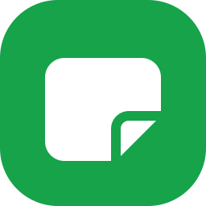

  

<h1 align="center">Estúdio de figurinhas</h1>

  Figurinha para WhatsApp — com ou sem som — feita no navegador. 
  <strong>feito por <a href="https://github.com/catevildev">catevildev</a></strong> · AGPL-3.0

  
  
  

---

## O que é

Um estúdio simples para criar figurinhas (estáticas ou animadas) e, se quiser, enviar **com som** para a conversa consigo mesmo no WhatsApp.

- Gerar e baixar **não** exige login  
- Envio com som usa pareamento do **seu** número  
- Projeto independente, sem vínculo com WhatsApp ou Meta  

## Onde falar com a gente

| | |
| :--- | :--- |
| **Bugs e ideias** | [Abrir uma issue](https://github.com/catevildev/MeowSticker/issues/new/choose) |
| **Versões** | [Releases / tags](https://github.com/catevildev/MeowSticker/releases) |
| **Desenvolvedor** | [@catevildev](https://github.com/catevildev) |

> O código-fonte do companion fica num repositório **privado**. Este repo é a vitrine pública, o canal de issues e o histórico de versões que aparece no site.

## Aviso

Uso pessoal. Conectar o WhatsApp por cliente não oficial é por sua conta e risco.  
Não publique sessões, tokens nem números de telefone nas issues.
